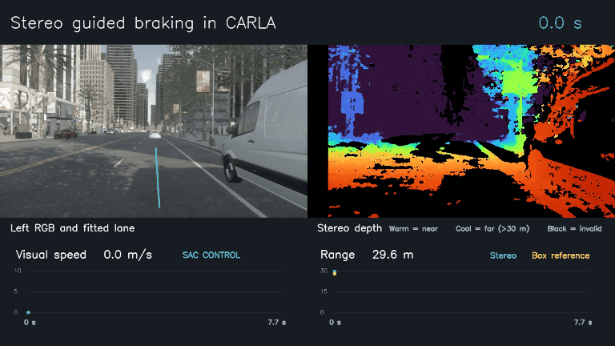
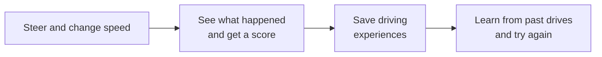
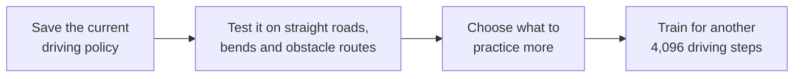
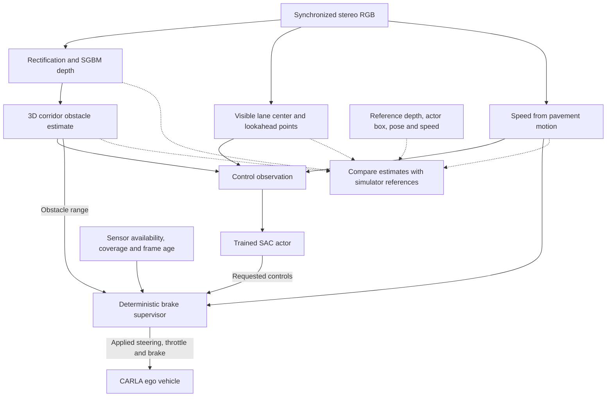

# RL-SAC-Driving-Geometric-Vision

**Can camera measurements alone train and drive a trajectory-tracking policy?** We trained SAC from scratch on lane, speed and obstacle estimates computed from rendered stereo frames. The reward and the training supervisor use visual measurements too. Frozen policies then drove in CARLA with stereo cameras and image-based speed estimation. Simulator truth scores the final experiments.

**[Watch all three videos in full resolution with autoplay](https://nandhini1github.github.io/RL-SAC-Driving-Geometric-Vision/)** · [Technical report](docs/technical-report.md)

### Fixed SAC in CARLA

[](https://nandhini1github.github.io/RL-SAC-Driving-Geometric-Vision/#fixed)

<details>
<summary>Play the full 1080p video with controls</summary>

https://github.com/user-attachments/assets/c6cfebe8-f0f7-4b22-98b1-e01f7c7706fa

</details>

The cyan line is the camera-fitted lane used for steering. Speed comes from pavement motion between left-camera frames. Stereo disparity supplies obstacle range and bearing. The adjacent plot overlays the independent reference range for evaluation.

### Adaptive SAC in CARLA

[](https://nandhini1github.github.io/RL-SAC-Driving-Geometric-Vision/#adaptive)

## Geometric vision on a live CARLA approach

Both seed-37 policies used the same camera rig, nominal 32 m parked-vehicle scenario, and deterministic brake. Fixed spawn coordinates placed the vehicles before driving. At each control step SAC received measured lane offset, heading, three lookaheads, visual speed, stereo obstacle features and its own preceding commands. The evaluator read actor velocity, pose, the box geometry, map centerline and reference depth after each command. Each column represents one run.

| Metric | Camera-based SAC with fixed training | Camera-based SAC with adaptive training |
|---|---:|---:|
| Frames scored | 81 | 78 |
| Recorded collisions | 0 | 0 |
| End condition | stopped under override | stopped under override |
| Final camera-to-box range | 3.50 m | 3.74 m |
| Brake override frames | 32 | 28 |
| True lateral tracking RMSE | 0.140 m | 0.047 m |
| Camera lane-offset estimation RMSE | 0.060 m | 0.039 m |
| Visual speed estimation RMSE | 1.32 m/s | 0.96 m/s |
| Stereo obstacle range MAE | 0.38 m | 0.41 m |
| Frames missing lane or speed | 2 | 3 |

SAC requested steering and acceleration. In both runs the deterministic supervisor applied full braking and held the vehicle at rest. Final clearance measures the distance from the left camera to the front-facing surface of the parked vehicle's bounding box. The independent depth camera scored the fixed run as follows.

| Reference depth | Valid-pixel coverage | Depth MAE | Depth RMSE |
|---|---:|---:|---:|
| 3 to 8 m | 69.5% | 0.37 m | 7.37 m |
| 8 to 16 m | 57.2% | 1.57 m | 7.85 m |
| 16 to 30 m | 63.6% | 5.99 m | 22.42 m |


Median camera processing time was 328 ms for the fixed run and 296 ms for the adaptive run. One straight road per checkpoint limits conclusions about transfer. [Fixed frame telemetry](results/carla_sensor/frames.csv) / [Adaptive frame telemetry](results/carla_sensor_adaptive/frames.csv)

Two independent checks isolate calibration and matching. Fitting a nonparallel synthetic rig from noisy board corners yielded **0.278 px** held-out 95th-percentile vertical rectification error. On ideal textured planes the depth MAE grew from **0.056 m at 4 m** to **0.772 m at 16 m**. [Calibration results](results/calibration.json) · [Synthetic depth plot](results/media/stereo.png)

## Reinforcement learning on held-out routes

### Why pure pursuit?

Each controller receives the same image-based estimates of the painted lane, including the visible bypass on obstacle routes. Pure pursuit gives the experiment a baseline that needs no training. It steers toward a waypoint 6 m ahead, while a separate proportional controller adjusts speed toward 5 m/s. Comparing SAC with this baseline tests what learning adds to the task of following a known path. Choosing a path around an obstacle is a separate planning problem.

Each SAC policy received **12,288 training transitions**. Within each seed, the two arms started from identical actor, critic, optimizer and replay states after 4,096 shared transitions. Each then trained for two equal stages. A uniform curriculum and a validation-driven curriculum faced the same 20 straight, 20 bend and 20 obstacle routes. Gymnasium renders two grayscale camera images per step. Stereo disparity supplies obstacle range, lane paint supplies the path features, and image motion supplies speed. Rewards and validation decisions use these measured quantities. No brake shield was applied during this comparison.

| Controller | Completed | Collision rate | Tracking RMSE | Mean return | Mean steering change |
|---|---:|---:|---:|---:|---:|
| Pure pursuit + speed control | 45/60 | 0.0% | 0.236 m | -1.38 | 0.0133 |
| Camera-based SAC with fixed training | 136/180 | 0.6% | 0.360 m | -28.22 | 0.0751 |
| Camera-based SAC with adaptive training | 115/180 | 0.0% | 0.313 m | -35.93 | 0.0696 |


The independent evaluator counts a completion when the vehicle gets within one metre of the 40 m finish without a recorded contact or lane departure. Training and validation use visual progress, a near-obstacle cue and loss of detected lane markings. The reward can disagree with true completion when visual speed drifts or paint becomes ambiguous. The same 60 held-out cases recur for all three training seeds. [Per-seed results](results/per_seed.csv) / [Camera feature accuracy](results/camera_accuracy.json)

| Held-out scene | Fixed SAC finishes | Adaptive SAC finishes | Camera lane-offset RMSE |
|---|---:|---:|---:|
| Straight | 55/60 | 54/60 | 0.09 m |
| Bend | 57/60 | 43/60 | 0.53 m |
| Obstacle | 24/60 | 18/60 | 0.77 m |

Across the three seeds, SAC completed 21 more trials with fixed training than with adaptive training. Adaptive SAC had a lower average tracking error. Pure pursuit produced the smoothest steering and lowest tracking error of the three. Both learned controllers struggled most on obstacle bypasses. The last column measures lane-estimation error on four held-out pure-pursuit runs per scene. Its increase from 0.09 m on straights to 0.77 m on bypasses identifies a perception weakness worth testing separately. The step budget was fixed in advance. These results measure performance at that budget and leave convergence open.


[](https://nandhini1github.github.io/RL-SAC-Driving-Geometric-Vision/#comparison)

## What the training agent learned from the logs

During adaptive training, a fixed rule uses camera-derived validation scores to choose which scenario gets more practice. During driving, SAC uses camera measurements to choose steering and acceleration. In a separate seed-37 experiment, local **Qwen2.5-7B** read the same kinds of metrics and chose bends at both training stages. Each decision allocated 60% of the next stage to bends. That policy completed **54/60** held-out routes with **0.231 m** tracking RMSE. Fixed SAC completed **49/60** on the same seed. This comparison covers one training seed. The model acts only between training stages. [Model reasons and validation inputs](results/control/llm_decisions.json) / [Scored episodes](results/control/llm_heldout.csv)

## STAR interview summary

**Situation.** A controller on a simulated road must deal with imperfect measurements of lane position, obstacles and speed. I wanted the learning process to experience those errors from its first step.

**Task.** Train SAC from camera measurements and test whether adaptive practice improves performance under the same training budget.

**Action.** I rendered stereo training pairs, estimated lane geometry and visual speed, built camera-based rewards and episode endings, and tested that changing hidden state behind identical frames could not change the training signals. I compared fixed SAC, adaptive SAC and pure pursuit, then ran both learned controllers in CARLA with camera-only inputs.

**Result.** Fixed SAC completed 136/180 held-out trials and adaptive SAC completed 115/180. In CARLA the fixed and adaptive runs recorded 0 and 0 collisions respectively, with 32 and 28 frames of brake override. The action log distinguishes the policy's request from the command that reached the vehicle.

## System architecture

### Where reinforcement learning happens

**How the car learns.** In Gymnasium, SAC steers and changes speed. After each move, stereo images show the painted lane and nearby obstacle. Visual odometry estimates movement, and the reward function scores the camera measurements. Staying close to the path earns a better score. Seeing an obstacle very close ahead or losing the lane incurs a penalty. SAC saves those experiences, practices on a sample of them, and updates how it drives on the next attempt.



**How practice is chosen.** Between training stages, we test the latest policy on the same validation routes. The fixed-training version keeps the same mix of routes. The adaptive version uses a rule or a local language model to choose which scenario to practice more often.



[Gymnasium environment](driving_environment/route.py) / [SAC training code](sac_training/experiment.py)

### How CARLA uses the trained policy

**The live drive uses inference only.** We tested two camera-based policies from seed 37, one trained with a fixed scenario mix and one with an adaptive mix. At each tick the actor predicts steering and a signed longitudinal command. The brake supervisor can replace that longitudinal command with full braking while retaining the actor's steering. The vehicle's motion produces the next camera pair. [CARLA control loop](carla_integration/drive.py)



Both training and deployment estimate lane features, speed and obstacle geometry from camera images. The simulator uses its world model to generate scenes and images. During control, the map, actor state and reference depth are isolated from the policy and brake.

## Reproduce on Windows

Tested with Python 3.12.12, Windows, CPU PyTorch 2.8.0 and an RTX 5060 Laptop GPU (8 GB) for CARLA rendering. From this repository in PowerShell:

```powershell
uv venv --python 3.12
uv pip install --python .venv/Scripts/python.exe torch==2.8.0 --index-url https://download.pytorch.org/whl/cpu
uv pip install --python .venv/Scripts/python.exe -r requirements-control.txt
$python = ".\.venv\Scripts\python.exe"
& $python -m evaluation.verify_camera_inputs
& $python -m evaluation.camera_accuracy
& $python -m evaluation.calibration
& $python -m evaluation.stereo_benchmark
& $python -m evaluation.replay_stereo
```

The last command runs obstacle localization on the **published stereo frames** and then scores depth against the saved references. It works without a running simulator.

```powershell
foreach ($trial in 37,83,109) { & $python -m sac_training.experiment --seed $trial }
& $python -m evaluation.figures
& $python -m evaluation.across_seeds
& $python -m evaluation.rl_video
```

Each training directory contains episode logs, validations, final tests, decisions and checkpoints. Training recreates the local common replay buffer. For the optional local LLM experiment, run a local Ollama server with `qwen2.5:7b` installed, then run `& $python -m agentic_supervisor.local_llm` after training seed 37. The decision log identifies the source if the model is unavailable and the deterministic selector takes over.

For live driving, set `$carlaDir` to an extracted **CARLA 1.0 Win64 shipping** directory. Use its matching cp312 Windows client wheel and a dedicated server. The capture temporarily enables synchronous stepping and restores world settings on exit.

```powershell
$wheel = Get-ChildItem "$carlaDir/PythonAPI/carla/dist/carla-1.0-cp312-cp312-win_amd64.whl"
uv pip install --python .venv/Scripts/python.exe $wheel.FullName
& "$carlaDir/CarlaUnreal.exe" -RenderOffScreen -nosound -quality-level=Low -carla-rpc-port=2540
```

When Town10HD_Opt is ready, run these from the project environment in a second PowerShell window:

```powershell
.\.venv\Scripts\python.exe -m carla_integration.drive --port 2540
.\.venv\Scripts\python.exe -m evaluation.carla_media --sensor-run
```

The default uses the seed-37 fixed SAC checkpoint. Repeat with `--checkpoint results/control/adaptive.zip --output results/carla_sensor_adaptive --capture .runtime/adaptive_capture` for adaptive SAC. For its media, pass `--run-dir results/carla_sensor_adaptive --capture-dir .runtime/adaptive_capture` to `evaluation.carla_media`. GPU rendering, weather, ambient objects and CPU load can change pixel metrics and wall-clock timings. The included Dockerfile describes a portable CPU experiment environment; the native Windows workflow above was exercised. The [technical report](docs/technical-report.md) covers the geometry, SAC objective, reward, vehicle dynamics, control transfer and limitations.
