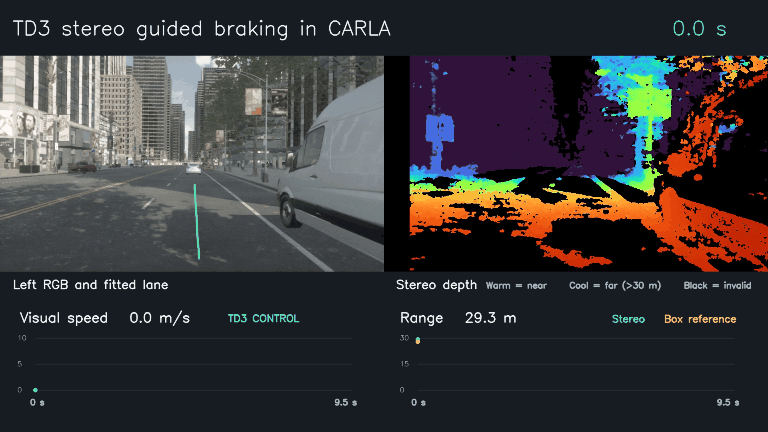
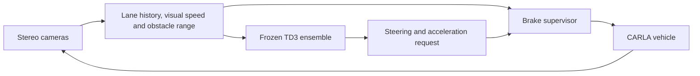
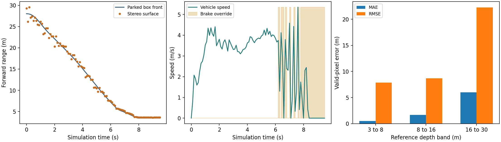
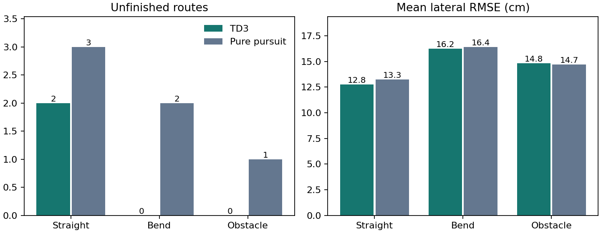

# RL-TD3-Driving-Geometric-Vision

Can a car learn steering and acceleration from camera measurements, then use the same policy in a different simulator? A frozen TD3 ensemble completed **598 of 600 held-out Gymnasium routes** and drove a straight approach to a parked car in **CARLA 1.0**. In CARLA, stereo vision measured the obstacle ahead, TD3 drove the approach, and a deterministic brake brought the vehicle to rest with **3.45 m of camera-to-box clearance**.

## Watch TD3 drive in CARLA

[](https://nandhini1github.github.io/RL-TD3-Driving-Geometric-Vision/#carla)

[Play the 1080p video with controls](https://nandhini1github.github.io/RL-TD3-Driving-Geometric-Vision/#carla) · [Open the MP4](https://nandhini1github.github.io/RL-TD3-Driving-Geometric-Vision/results/carla_td3/media/carla-stereo-stop.mp4) · [Frame-by-frame telemetry](results/carla_td3/frames.csv)

<details>
<summary>Play the CARLA recording in the README</summary>

<video controls autoplay muted playsinline loop width="960" src="https://nandhini1github.github.io/RL-TD3-Driving-Geometric-Vision/results/carla_td3/media/carla-stereo-stop.mp4"></video>

</details>

The cyan line follows the center of the lane fitted from visible paint in the left image. On the right, warm colors indicate nearby surfaces, cool colors indicate greater depth, and black pixels have no valid stereo match. The orange range trace uses the parked car’s bounding box for evaluation. The control indicator shows when the brake supervisor overrides TD3. Playback is half speed. The clock shows simulation time.

## Why TD3?

Steering and acceleration are continuous. TD3 learns an actor that can issue both commands directly from lane position, camera-estimated speed, obstacle geometry and its previous commands. The actor first imitates driving demonstrations. During offline training, two critics estimate how much future camera-derived reward an action will earn. TD3 uses the lower estimate in its training target and updates the actor less often than the critics. These choices limit the effect of overoptimistic action values. Keeping an imitation term during training anchors the actor to demonstrated behavior.

TD3 keeps the longitudinal policy fixed and learns steering from the current camera measurements and a short history of visible lane markings. At each step the controller takes the median steering request and median acceleration request across three training seeds. [Training and checkpoint selection](docs/td3-experiment.md)

## What the stereo cameras measured

The CARLA rig used two synchronized 960 × 540 RGB cameras spaced 0.32 m apart. Rectification aligned their image rows. OpenCV StereoSGBM matched features between the views, producing a horizontal disparity `d`. Optical depth was `Z = fB/d`, with focal length `f` in pixels and camera separation `B` in metres. The controller used the estimated range and bearing of a connected group of points above the road in the driving lane. Successive pavement images supplied speed. [Geometry, calibration and coordinate frames](docs/technical-report.md)



The same frozen steering and longitudinal weights used in Gymnasium ran unchanged on Town10HD_Opt. The simulator supplied the initial scene and rendered sensor images. During driving the actor and brake received camera estimates. Reference depth, vehicle pose and velocity, map centerline, parked box and collision events were used for scoring. [Run metadata and checkpoint hashes](results/carla_td3/run.json) · [Control loop](carla_integration/drive.py)

| Single CARLA approach | Measured result |
|---|---:|
| Control frames / frames with brake override | 96 / 25 |
| Recorded collisions | 0 |
| Final distance from left camera to parked box | 3.45 m |
| Stereo obstacle-range mean absolute error | 0.43 m |
| Lane-offset estimation RMSE | 0.051 m |
| Vehicle tracking RMSE against the lane center | 0.007 m |
| Camera speed RMSE against simulator velocity | 0.83 m/s |
| Median vision time / median TD3 ensemble inference time on CPU | 88.68 ms / 0.73 ms |



The 0.43 m range error describes one obstacle surface. Dense depth was less accurate at longer range. At 3–8 m, 36.1% of reference pixels had valid predictions, with 0.52 m mean absolute error. At 16–30 m, coverage was 64.8% and mean absolute error was 5.99 m. This single drive demonstrates closed-loop transfer on a straight road. Generalization to traffic, curved roads and weather requires additional CARLA trials. [Depth results by range](results/carla_td3/metrics.json) · [Replayable stereo examples](results/carla_td3/sample_points.json)

## Gymnasium route completion

Both controllers drove the same **600 held-out routes**, with 200 straights, 200 bends and 200 obstacle bypasses. Both use the same lane history derived from camera observations. Pure pursuit steers toward the estimated centerline 3.5 m ahead and targets 4.0 m/s. TD3 issues learned steering and acceleration commands.

| Controller | Clean finishes | Lateral tracking RMSE | Contacts |
|---|---:|---:|---:|
| TD3 | 598/600 (99.7%) | 14.61 cm | 0 |
| Pure pursuit | 594/600 (99.0%) | 14.78 cm | 0 |

TD3 finished four additional routes and reduced mean per-route lateral RMSE by **0.17 cm**. On the 594 routes both finished, RMSE was 14.64 cm for TD3 and 14.80 cm for Pure pursuit. The adjusted paired interval for the completion gain spans 0 to 1.5 percentage points, so a tie in completion remains plausible. [Per-route scores and uncertainty](docs/td3-committee.md) · [Watch both controllers on the same obstacle bypass](https://nandhini1github.github.io/RL-TD3-Driving-Geometric-Vision/#td3)



## Reproduce on Windows

Use Python 3.12 from the repository root. The saved weights, stereo sample pairs and evaluation results are included. These commands replay the geometry and rebuild the head-to-head plot without launching CARLA.

```powershell
uv venv --python 3.12
uv pip install --python .venv/Scripts/python.exe torch==2.8.0 --index-url https://download.pytorch.org/whl/cpu
uv pip install --python .venv/Scripts/python.exe -r requirements-control.txt
$py = ".\.venv\Scripts\python.exe"
& $py -m evaluation.verify_camera_inputs
& $py -m evaluation.replay_stereo
& $py -m evaluation.tracking summary
```

To repeat the live run, set `$carlaDir` to the installed CARLA 1.0 Win64 shipping folder. Install its matching client wheel and start a dedicated offscreen server with Town10HD_Opt loaded.

```powershell
$wheel = Get-Item "$carlaDir/PythonAPI/carla/dist/carla-1.0-cp312-cp312-win_amd64.whl"
uv pip install --python .venv/Scripts/python.exe $wheel.FullName
Start-Process "$carlaDir/CarlaUnreal.exe" -ArgumentList '-RenderOffScreen','-nosound','-quality-level=Low','-carla-rpc-port=2540' -WindowStyle Hidden
```

Once the server is ready, run the capture and render the video. The capture restores the server’s settings when it exits. To keep the published recording intact, write a repeat to separate directories.

```powershell
& $py -m carla_integration.drive --port 2540 --output .runtime/repeat --capture .runtime/repeat-frames
& $py -m evaluation.carla_media --run-dir .runtime/repeat --capture-dir .runtime/repeat-frames
```

[Train TD3 from the demonstration dataset](docs/td3-experiment.md) · [Reproduce the paired evaluation](docs/td3-committee.md) · [Technical report](docs/technical-report.md)
