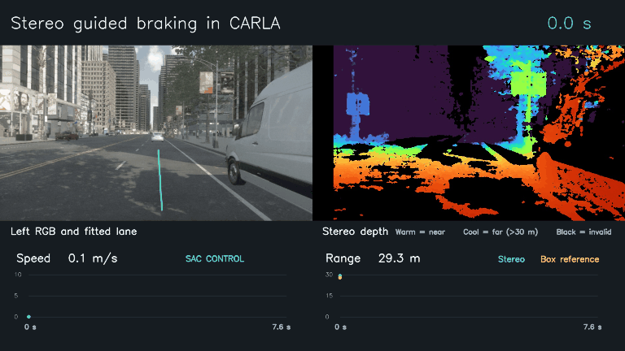
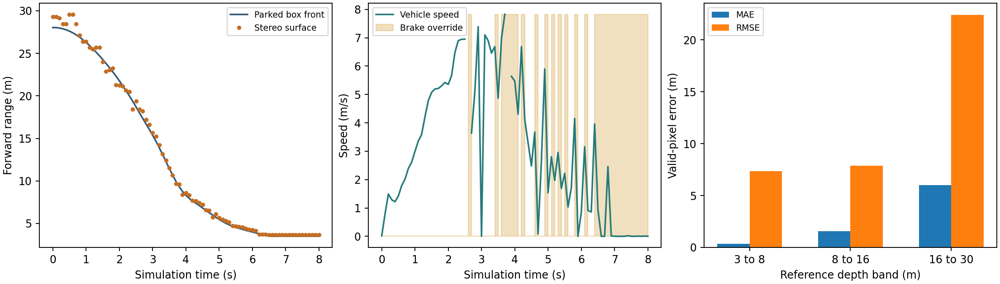
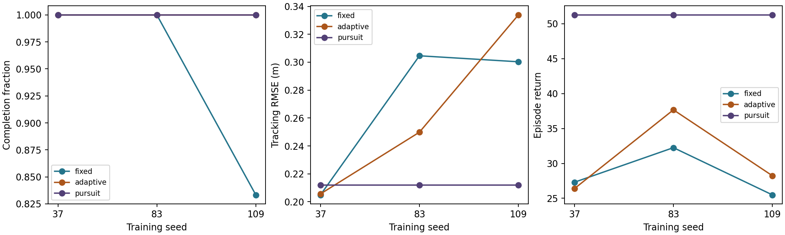
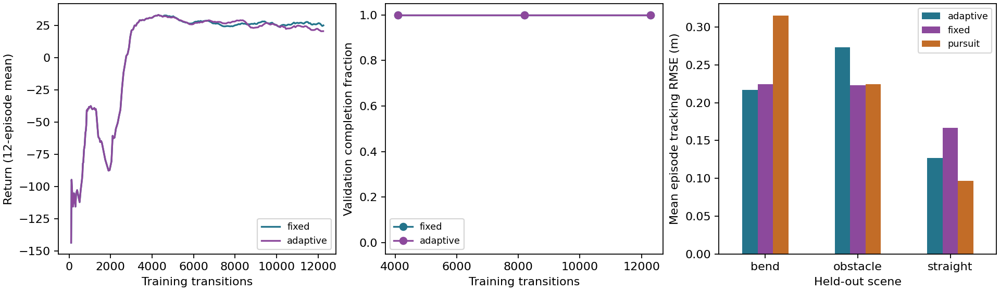
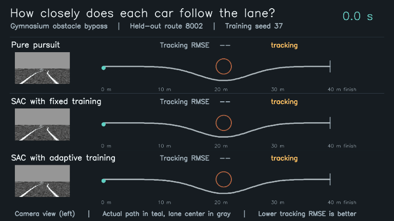
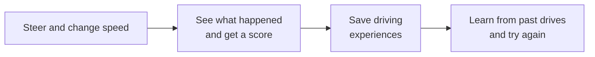
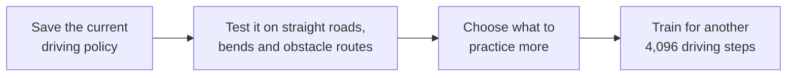
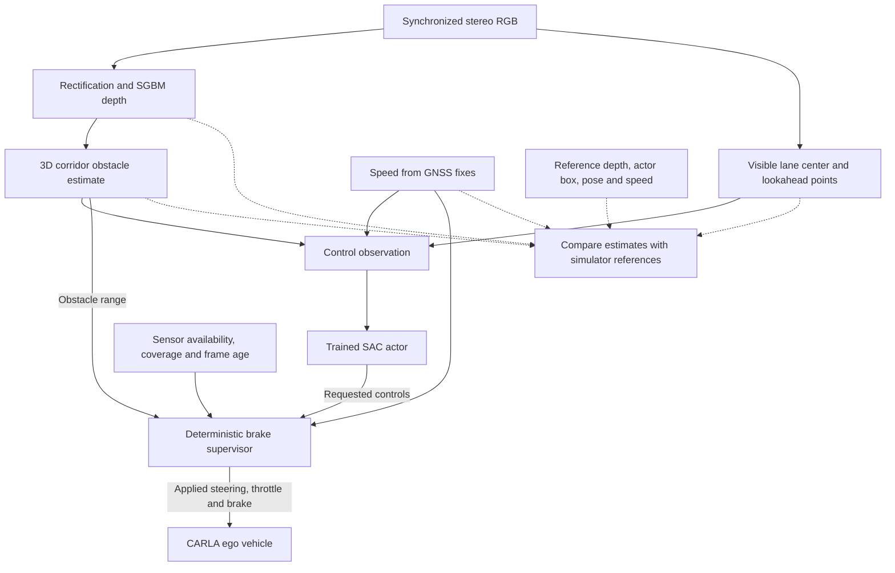

# RL-SAC-Driving-Geometric-Vision

**Can a stereo range estimate transfer into a learned driving controller, and does adaptive training improve that controller?** This project tests both questions with a Windows CARLA 1.0 stereo rig, a Gymnasium bicycle model, and Soft Actor-Critic (SAC). Three training seeds compare fixed and adaptive curricula. A separate experiment gives a local language model bounded authority over scenario sampling.



<details>
<summary>Play the full 1080p video with controls</summary>

https://github.com/user-attachments/assets/6b1a6bd9-b623-4bbb-9746-ca05c4c5ecbe

</details>

**[Watch the 1080p CARLA stereo and braking video](https://github.com/Nandhini1github/RL-SAC-Driving-Geometric-Vision/raw/refs/heads/main/results/carla_sensor/media/carla-stereo-stop.mp4)** · **[Watch the 900p controller comparison](https://github.com/Nandhini1github/RL-SAC-Driving-Geometric-Vision/raw/refs/heads/main/results/media/controllers.mp4)** · [Technical report](docs/technical-report.md)

The CARLA film displays both 960 × 540 sensor panels at native resolution. Its half-speed playback shows the speed response and exact brake-override frames. The second film replays three controllers on the same held-out Gymnasium route. All reference trajectories in these experiments are deterministic.

## Geometric vision on a live CARLA approach

A Tesla Model 3 approached a parked vehicle using **camera-derived lane guidance, stereo obstacle range and GNSS-estimated speed**. The map placed the two cars at the start. During driving, the policy received local lane offsets at 3, 6 and 10 m from the camera fit. It also received obstacle range and bearing from stereo, speed from timestamped GNSS fixes, and its previous applied command. Simulator pose, velocity, depth and actor geometry were reserved for evaluation during the run.

| Metric | Sensor-driven approach (SAC seed 37) |
|---|---:|
| Control frames | 77 |
| Recorded collisions | 0 |
| Final camera-to-box clearance | 3.06 m |
| Frames with brake override | 36 |
| Lateral tracking RMSE against the evaluation centerline | 0.210 m |
| Stereo obstacle range MAE | 0.56 m |

The sensor-driven run produced a lane fit and speed estimate on all 77 frames. **Lane-offset estimation RMSE was 0.147 m** against the map and **speed estimation RMSE was 0.494 m/s** against the actor velocity. These measure the estimators. The 0.210 m tracking RMSE measures how accurately the vehicle actually followed the lane. At the final stop the policy still requested positive acceleration, so the deterministic brake deserves credit for stopping the vehicle.

| Sensor-driven run: reference depth | Valid-pixel coverage | Depth MAE | Depth RMSE |
|---|---:|---:|---:|
| 3-8 m | 37.2% | 0.58 m | 8.28 m |
| 8-16 m | 56.7% | 1.86 m | 8.75 m |
| 16-30 m | 61.4% | 6.39 m | 23.19 m |



Median image processing time was 158 ms per synchronized frame. A coherent obstacle surface remained easier to locate than individual distant pixels. The test used a level straight street with visible paint, one parked obstacle and a fixed simulation step. [Sensor-run measurements](results/carla_sensor/frames.csv) / [Sensor-run metrics](results/carla_sensor/metrics.json)

Two independent checks isolate calibration and matching. Fitting a nonparallel synthetic rig from noisy board corners yielded **0.278 px** held-out 95th-percentile vertical rectification error. On ideal textured planes the depth MAE grew from **0.056 m at 4 m** to **0.772 m at 16 m**. [Calibration results](results/calibration.json) · [Synthetic depth plot](results/media/stereo.png)

## Reinforcement learning on held-out routes

### Why pure pursuit?

Each controller receives the same reference path, including a predefined bypass on obstacle routes. Pure pursuit gives the experiment a baseline that needs no training. It steers toward a waypoint 6 m ahead, while a separate proportional controller adjusts speed toward 5 m/s. Comparing SAC with this baseline tests what learning adds to the task of following a known path. Choosing a path around an obstacle is a separate planning problem.

Each SAC policy received **12,288 training transitions**. Within each seed, the two arms started from identical actor, critic, optimizer and replay states after 4,096 shared transitions. Each then trained for two equal stages. A uniform curriculum and a validation-driven curriculum faced the same 20 straight, 20 bend and 20 obstacle routes. Gymnasium obstacle observations use analytic scene geometry. No brake shield was applied during this comparison.

| Controller | Completed | Collision rate | Tracking RMSE | Mean return | Mean steering change |
|---|---:|---:|---:|---:|---:|
| Pure pursuit + proportional speed control | 60/60 | 0% | 0.212 m | 51.27 | 0.0121 |
| Fixed-distribution SAC | 170/180 | 5.6% | 0.270 m | 28.35 | 0.0398 |
| Rule-guided adaptive SAC | 180/180 | 0% | 0.263 m | 30.77 | 0.0381 |



**The ten fixed-policy collisions all occurred in obstacle scenarios for training seed 109.** Adaptive training emphasized obstacles in both stages for that seed and completed all 60 routes. The other two seeds already had perfect completion with fixed training. Pure pursuit completed all 60 routes with lower average tracking RMSE (0.212 m versus 0.263 m for adaptive SAC), smoother steering and higher return. Adaptive practice helped SAC in its failure-prone seed, while pure pursuit remained the more accurate tracker overall on these short, mapped routes. Policy latency averaged 0.31 ms for fixed SAC, 0.37 ms for adaptive SAC and 0.005 ms for pure pursuit on this machine. [Per-seed results](results/per_seed.csv) · [Aggregate results](results/aggregate.csv)





## What the training agent learned from the logs

The rule-guided supervisor audits validation failures after each stage. Its only decision is which of three scenarios receives 60% of the next stage, with the other two receiving 20% each. The **separate local Qwen2.5-7B arm** selected bends twice. It completed **60/60** seed-37 test routes with **0.215 m** tracking RMSE and **24.69** mean return. On that same seed fixed SAC achieved **0.205 m** and **27.30**.

The LLM correctly identified bends as the highest-error scenario after the common checkpoint. At the second decision it again called bends the highest-error case (0.246 m), although obstacles had reached 0.324 m. The saved decision record exposes the error and the exact training change it caused. This pilot provides no performance advantage for the language-model selector. [LLM decisions and inputs](results/control/llm_decisions.json) · [LLM held-out episodes](results/control/llm_heldout.csv)

## STAR interview summary

**Situation.** A controller can track a simulated route when it knows the lane and obstacle positions exactly. In a camera-driven vehicle, those quantities have to be estimated. I wanted to understand how well a learned controller handled that transition.

**Task.** I set out to answer two questions. Would practicing difficult routes improve a Soft Actor-Critic (SAC) policy under a fixed training budget? Could a frozen policy use sensor measurements to approach a parked car in CARLA?

**Action.** I trained fixed and adaptive versions of SAC from identical checkpoints across three seeds and evaluated them on the same routes alongside pure pursuit. For the CARLA test, I estimated obstacle distance from stereo disparity, fitted the lane center from camera images, and estimated speed from GNSS. I logged both the policy's requested commands and the commands applied by the brake supervisor so I could tell what actually stopped the vehicle.

**Result.** Adaptive SAC completed 180 of 180 held-out Gymnasium episodes. Fixed SAC completed 170, with all ten collisions concentrated in one training seed. Pure pursuit still had the lowest average tracking error. In the separate CARLA test, the fixed SAC policy drove one straight approach using sensor inputs. Stereo range error averaged 0.56 m in absolute terms, and the deterministic brake brought the car to a stop with 3.06 m of camera-to-obstacle clearance.

## System architecture

### Where reinforcement learning happens

**How the car learns.** In Gymnasium, SAC steers and changes speed. After each move, the simulator shows what happened and gives it a score. Staying close to the path earns a better score. Collisions and leaving the lane hurt it. SAC saves those experiences, practices on a sample of them, and updates how it drives on the next attempt.



**How practice is chosen.** Between training stages, we test the latest policy on the same validation routes. The fixed-training version keeps the same mix of routes. The adaptive version uses a rule or a local language model to choose which scenario to practice more often.



[Gymnasium environment](driving_environment/route.py) / [SAC training code](sac_training/experiment.py)

### How CARLA uses the trained policy

**The live drive uses inference only.** CARLA loads the fixed-distribution checkpoint from training seed 37. At each tick the actor predicts steering and a signed longitudinal command. The brake supervisor can replace that longitudinal command with full braking while retaining the actor's steering. The vehicle's motion produces the next camera pair and ego state. [CARLA control loop](carla_integration/drive.py)



The training environment generates analytic waypoints and obstacle features. In the sensor-driven CARLA run, the camera supplies lane offset, heading error and local lookahead points. The two cameras supply obstacle range and bearing. GNSS supplies speed. The simulator map is used for scenario setup and evaluation.

## Reproduce on Windows

Tested with Python 3.12.12, Windows, CPU PyTorch 2.8.0 and an RTX 5060 Laptop GPU (8 GB) for CARLA rendering. From this repository in PowerShell:

```powershell
uv venv --python 3.12
uv pip install --python .venv/Scripts/python.exe torch==2.8.0 --index-url https://download.pytorch.org/whl/cpu
uv pip install --python .venv/Scripts/python.exe -r requirements-control.txt
$python = ".\.venv\Scripts\python.exe"
& $python -m evaluation.calibration
& $python -m evaluation.stereo_benchmark
& $python -m evaluation.replay_stereo
```

The last command runs obstacle localization on the **published stereo frames** and then scores depth against the saved references. It works without a running simulator.

```powershell
foreach ($trial in 37,83,109) { & $python -m sac_training.experiment --seed $trial }
& $python -m evaluation.figures
& $python -m evaluation.across_seeds
& $python -m evaluation.rl_video
```

Each training directory contains episode logs, validations, final tests, decisions and checkpoints. Training recreates the local common replay buffer. For the optional local LLM experiment, run a local Ollama server with `qwen2.5:7b` installed, then run `& $python -m agentic_supervisor.local_llm` after training seed 37. The decision log identifies the source if the model is unavailable and the deterministic selector takes over.

For live driving, set `$carlaDir` to an extracted **CARLA 1.0 Win64 shipping** directory. Use its matching cp312 Windows client wheel and a dedicated server. The capture temporarily enables synchronous stepping and restores world settings on exit.

```powershell
$wheel = Get-ChildItem "$carlaDir/PythonAPI/carla/dist/carla-1.0-cp312-cp312-win_amd64.whl"
uv pip install --python .venv/Scripts/python.exe $wheel.FullName
& "$carlaDir/CarlaUnreal.exe" -RenderOffScreen -nosound -quality-level=Low -carla-rpc-port=2540
```

When Town10HD_Opt is ready, run these from the project environment in a second PowerShell window:

```powershell
.\.venv\Scripts\python.exe -m carla_integration.drive --port 2540
.\.venv\Scripts\python.exe -m evaluation.carla_media --sensor-run
```

The live script uses the seed-37 fixed SAC checkpoint. GPU rendering, weather, ambient objects and CPU load can change pixel metrics and wall-clock timings. The included Dockerfile describes a portable CPU experiment environment; the native Windows workflow above was exercised. The [technical report](docs/technical-report.md) covers the geometry, SAC objective, reward, vehicle dynamics, control transfer and limitations.
