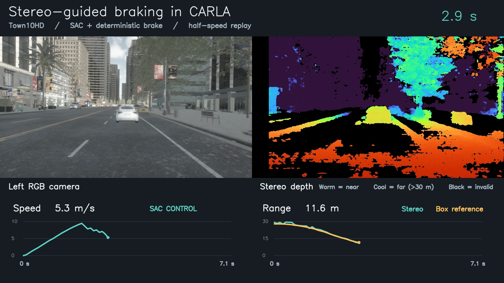
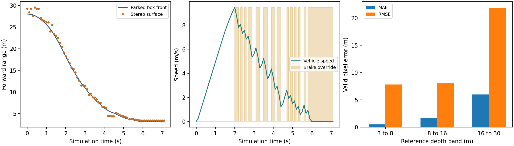
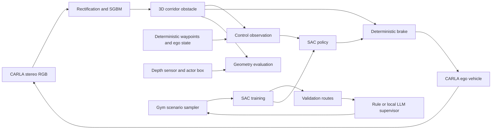

# Agentic-VLA-SAC-Driving

**Can a stereo range estimate transfer into a learned driving controller, and does adaptive training improve that controller?** This project tests both questions with a Windows CARLA 1.0 stereo rig, a Gymnasium bicycle model, and Soft Actor-Critic (SAC). Three training seeds compare fixed and adaptive curricula. A separate experiment gives a local language model bounded authority over scenario sampling.

[](https://github.com/Nandhini1github/Agentic-VLA-SAC-Driving/raw/refs/heads/main/results/media/carla-stereo-stop.mp4)

**[Watch the 1080p CARLA stereo and braking video](https://github.com/Nandhini1github/Agentic-VLA-SAC-Driving/raw/refs/heads/main/results/media/carla-stereo-stop.mp4)** · **[Watch the 900p controller comparison](https://github.com/Nandhini1github/Agentic-VLA-SAC-Driving/raw/refs/heads/main/results/media/controllers.mp4)** · [Technical report](docs/technical-report.md)

The CARLA film displays both 960 × 540 sensor panels at native resolution. Its half-speed playback shows the speed response and exact brake-override frames. The second film replays three controllers on the same held-out Gym route. OpenDriveVLA remains a researched extension. All reference trajectories in these experiments are deterministic.

## Geometric vision on a live CARLA approach

A Tesla Model 3 approached a stationary vehicle on Town10HD. The controller received speed, map-relative tracking features and a corridor obstacle estimate from the synchronized RGB stereo pair. The aligned depth camera and parked vehicle bounding box supplied evaluation references. The final run reached **9.48 m/s**, recorded **zero collisions** and stopped **3.16 m** from the parked box, measured forward from the left camera. The deterministic brake overrode SAC on **33 of 72 frames**. On the final frame SAC still requested **+0.91** normalized longitudinal command.

| Reference depth | Valid-pixel coverage | Depth MAE | Depth RMSE |
|---|---:|---:|---:|
| 3–8 m | 38.4% | 0.52 m | 7.84 m |
| 8–16 m | 56.8% | 1.66 m | 8.04 m |
| 16–30 m | 60.6% | 5.98 m | 21.91 m |



The stereo estimator returned a corridor surface in all 72 frames. Its forward range had **0.44 m MAE** and **0.63 m RMSE** against the parked box front. The dense depth map was less reliable, particularly at long range. Small disparity errors amplify with depth, and the gap between MAE and RMSE shows that some accepted correspondences were badly wrong. Median geometry processing latency was **186 ms** at 960 × 540. The run used synchronous stepping at 0.1 simulation seconds per frame. This single approach establishes a working integration with a brake override. [Frame-level measurements](results/carla/frames.csv) · [Metrics](results/carla/metrics.json) · [Replayable image pairs](results/carla)

Two independent checks isolate calibration and matching. Fitting a nonparallel synthetic rig from noisy board corners yielded **0.278 px** held-out 95th-percentile vertical rectification error. On ideal textured planes the depth MAE grew from **0.056 m at 4 m** to **0.772 m at 16 m**. [Calibration results](results/calibration.json) · [Synthetic depth plot](results/media/stereo.png)

## Reinforcement learning on held-out routes

Each SAC policy received **12,288 training transitions**. Within each seed, the two arms started from identical actor, critic, optimizer and replay states after 4,096 shared transitions. Each then trained for two equal stages. A uniform curriculum and a validation-driven curriculum faced the same 20 straight, 20 bend and 20 obstacle routes. Gym obstacle observations use analytic scene geometry. No brake shield was applied during this comparison.

| Controller | Completed | Collision rate | Tracking RMSE | Mean return | Mean steering change |
|---|---:|---:|---:|---:|---:|
| Pure pursuit + proportional speed control | 60/60 | 0% | 0.212 m | 51.27 | 0.0121 |
| Fixed-distribution SAC | 170/180 | 5.6% | 0.270 m | 28.35 | 0.0398 |
| Rule-guided adaptive SAC | 180/180 | 0% | 0.263 m | 30.77 | 0.0381 |


**The ten fixed-policy collisions all occurred in obstacle scenarios for training seed 109.** Adaptive training emphasized obstacles in both stages for that seed and completed all 60 routes. The other two seeds already had perfect completion with fixed training. Pure pursuit achieved the best overall tracking error, return and steering smoothness. These are short, mapped routes with a supplied bypass path. The result supports a curriculum effect in one failure-prone seed and shows why a classical baseline matters. Policy latency averaged 0.31 ms for fixed SAC, 0.37 ms for adaptive SAC and 0.005 ms for pure pursuit on this machine. [Per-seed results](results/per_seed.csv) · [Aggregate results](results/aggregate.csv)


## What the training agent learned from the logs

The rule-guided supervisor audits validation failures after each stage. Its only decision is which of three scenarios receives 60% of the next stage, with the other two receiving 20% each. The **separate local Qwen2.5-7B arm** selected bends twice. It completed **60/60** seed-37 test routes with **0.215 m** tracking RMSE and **24.69** mean return. On that same seed fixed SAC achieved **0.205 m** and **27.30**.

The LLM correctly identified bends as the highest-error scenario after the common checkpoint. At the second decision it again called bends the highest-error case (0.246 m), although obstacles had reached 0.324 m. The saved decision record exposes the error and the exact training change it caused. This pilot provides no performance advantage for the language-model selector. [LLM decisions and inputs](results/control/llm_decisions.json) · [LLM held-out episodes](results/control/llm_heldout.csv)

## System architecture



OpenDriveVLA-0.5B has a published, gated checkpoint and an official nuScenes evaluator. It consumes UniAD data and produces decoded answers from which the evaluator extracts six waypoints. The released Python 3.10 / PyTorch 2.1.2 custom-operator stack poses a compatibility risk on the RTX 5060 Laptop GPU. We did not run pretrained inference. The tested CARLA path uses map references and the Gym path uses analytic waypoints. [Upstream audit and exact dependencies](docs/opendrivevla.md)

## Reproduce on Windows

Tested with Python 3.12.12, Windows, CPU PyTorch 2.8.0 and an RTX 5060 Laptop GPU (8 GB) for CARLA rendering. From this repository in PowerShell:

```powershell
uv venv --python 3.12
uv pip install --python .venv/Scripts/python.exe torch==2.8.0 --index-url https://download.pytorch.org/whl/cpu
uv pip install --python .venv/Scripts/python.exe -r requirements-control.txt
$python = ".\.venv\Scripts\python.exe"
& $python -m evaluation.calibration
& $python -m evaluation.stereo_benchmark
& $python -m evaluation.replay_stereo
```

The last command runs obstacle localization on the **published stereo frames** and then scores depth against the saved references. It works without a running simulator.

```powershell
foreach ($trial in 37,83,109) { & $python -m sac_training.experiment --seed $trial }
& $python -m evaluation.figures
& $python -m evaluation.across_seeds
& $python -m evaluation.rl_video
```

Each training directory contains episode logs, validations, final tests, decisions and checkpoints. Training recreates the local common replay buffer. For the optional local LLM experiment, run a local Ollama server with `qwen2.5:7b` installed, then run `& $python -m agentic_supervisor.local_llm` after training seed 37. The decision log identifies the source if the model is unavailable and the deterministic selector takes over.

For live driving, set `$carlaDir` to an extracted **CARLA 1.0 Win64 shipping** directory. Use its matching cp312 Windows client wheel and a dedicated server. The capture temporarily enables synchronous stepping and restores world settings on exit.

```powershell
$wheel = Get-ChildItem "$carlaDir/PythonAPI/carla/dist/carla-1.0-cp312-cp312-win_amd64.whl"
uv pip install --python .venv/Scripts/python.exe $wheel.FullName
& "$carlaDir/CarlaUnreal.exe" -RenderOffScreen -nosound -quality-level=Low -carla-rpc-port=2540
```

When Town10HD_Opt is ready, run these from the project environment in a second PowerShell window:

```powershell
.\.venv\Scripts\python.exe -m carla_integration.drive --port 2540
.\.venv\Scripts\python.exe -m evaluation.carla_media
```

The live script uses the seed-37 fixed SAC checkpoint. GPU rendering, weather, ambient objects and CPU load can change pixel metrics and wall-clock timings. The included Dockerfile describes a portable CPU experiment environment; the native Windows workflow above was exercised. The [technical report](docs/technical-report.md) covers the geometry, SAC objective, reward, vehicle dynamics, control transfer and limitations.
