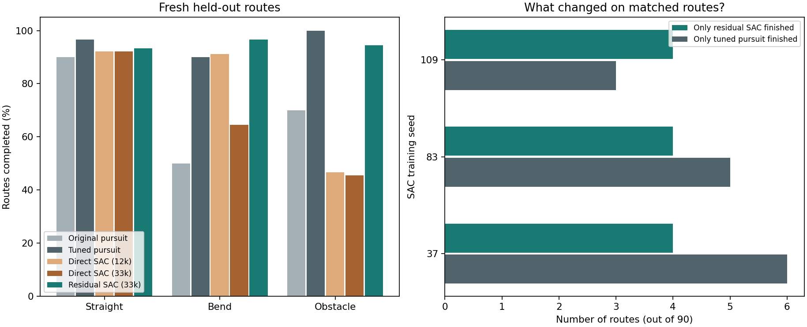
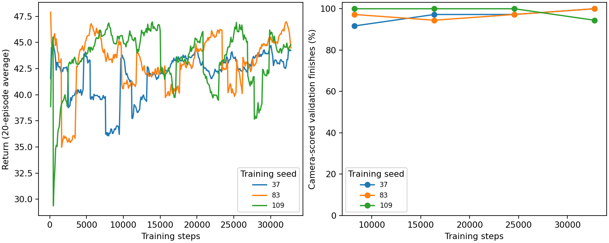

# Can learned corrections improve camera based route completion?

## Results on unseen routes

Residual SAC completed **256 of 270 trials (94.8%)**, compared with **182 of 270 (67.4%)** for direct-action SAC at the same 32,768-step training budget. The biggest difference was on the obstacle bypasses, where residual SAC completed 85/90 trials and equal-budget direct SAC completed 41/90. The new training recipe combined a geometric starting controller, bounded actions, camera-validity flags and a revised reward. The comparison measures those changes together.

| Controller | Training steps per seed | Finished | Recorded contacts | Mean episode lateral RMSE |
|---|---:|---:|---:|---:|
| Original pure pursuit | 0 | 63/90 (70.0%) | 0 | 0.249 m |
| Tuned pure pursuit | 0 | 86/90 (95.6%) | 0 | 0.164 m |
| Earlier direct SAC | 12,288 | 207/270 (76.7%) | 7 | 0.378 m |
| Direct SAC, matched budget | 32,768 | 182/270 (67.4%) | 16 | 0.305 m |
| Residual SAC | 32,768 | 256/270 (94.8%) | 0 | 0.207 m |

**What did RL add to tuned pure pursuit?** The paired completion difference was **−0.74 percentage points**. The descriptive 95% bootstrap interval was −7.04 to +5.93 points, resampling training seeds and route seeds while keeping the three scenes together. The prespecified improvement criterion was unmet. On the 244 paired trials both finished, residual SAC first reached the finish threshold in 10.01 s on average, compared with 10.38 s for tuned pursuit. This time comparison excludes failures. Both recorded zero contacts. The tuned geometric controller had the lowest overall tracking error.

| Training seed | Direct SAC finishes at equal budget | Residual SAC finishes | Only residual finished vs tuned pursuit | Only tuned pursuit finished vs residual |
|---|---:|---:|---:|---:|
| 37 | 51/90 | 84/90 | 4 | 6 |
| 83 | 44/90 | 85/90 | 4 | 5 |
| 109 | 87/90 | 87/90 | 4 | 3 |

The selected pure-pursuit controller used a 4.5 m lookahead and 4 m/s target. Camera-loss endings fell from 25/90 with original pursuit to 3/90 after tuning. Residual SAC had 5/270 camera-loss endings versus 43/270 for equal-budget direct SAC. These are measurements from the lightweight simulator. The three training seeds reuse the same 90 routes.





[Main episode log](../results/residual/heldout.csv) · [Equal-budget direct SAC episodes](../results/residual/heldout_direct.csv) · [Summary and paired statistics](../results/residual/summary.json) · [Geometric controller selection](../results/residual/baseline.json)

## Evaluation protocol

Pure pursuit supplies the first steering and acceleration estimate. SAC observes camera geometry and predicts a bounded adjustment to those commands. With the adjustment disabled, the car drives using exactly the same tuned pure-pursuit controller. This makes it possible to measure what the learned action contributes. [Johannink et al., Residual Reinforcement Learning for Robot Control](https://arxiv.org/abs/1812.03201)

The primary comparison is bounded residual SAC against its own geometric controller with the learned correction set to zero. The previous pure-pursuit controller is a second reference. All three use the original camera pipeline, road generator, bicycle dynamics, episode endings and independent success definition. The two availability flags expose whether the speed and lane estimates were valid. Simulator state is used to generate images and score final runs.

Before opening the new test set, the criterion for an improvement in completion was set to **at least five percentage points higher mean completion than tuned pure pursuit**, with a positive difference for each of three training seeds and no increase in the pooled observed contact rate. The unit of comparison is a matched route. The 90 distinct routes are repeated across training seeds. Average lateral tracking RMSE covers the portion driven, so it is a secondary measure.

## Training and selection

1. Tune a geometric controller on 36 camera-scored validation cases (seeds 6000 through 6011 in each scene). Test lookaheads of 4.5, 6 and 7.5 metres crossed with three speed schedules: 4 m/s, 5 m/s, and 5 m/s with a reduction for a camera-detected bend. Select by visual finishes, then fewer visual hazard endings, then lower mean episode visual lane RMSE.
2. Train SAC from scratch on top of the selected controller. The actor can change normalized steering by at most 0.20 and normalized longitudinal command by at most 0.45. The camera-derived reward credits progress and a visual finish and charges for elapsed time, lateral error, steering changes, correction magnitude, unreadable measurements and unsuccessful endings. Camera failures still end episodes under the original rules.
3. Use uniform scenario sampling and independent training seeds 37, 83 and 109, each with 32,768 steps. Evaluate checkpoints every 8,192 steps. Select the checkpoint for each seed using the same camera-only validation ranking. Keep the earliest checkpoint in a tie. This comparison tests the trained residual on top of the tuned baseline. It cannot identify which individual change to the training recipe caused an outcome.
4. After selection, evaluate all controllers on seeds 12000 through 12029 in each of the three scenes. Every actor receives only camera measurements and its previous commands. The held-out evaluator independently records true completion, contact and lateral error. Report all three seeds and all three scene types regardless of the outcome. This test is in Gymnasium.

For context, also score the three previously published fixed-training SAC checkpoints on the new routes. Those checkpoints used 12,288 transitions and their original reward. Any difference from residual SAC combines several training changes. On paired successful routes, compare time to first reach the finish threshold to expose a possible speed versus reliability trade-off.

A second direct-action SAC control receives the same 32,768-step budget, optimizer settings, training seeds and camera-only checkpoint-selection procedure as residual SAC. It retains the original reward and control observations. It tests whether allowing direct SAC more training closes the gap. The primary comparison remains residual SAC against the tuned geometric controller. This secondary control was specified before either held-out evaluation.

The executed command is `clip(base + [0.20, 0.45] * correction, -1, 1)`. Each component of the SAC correction lies between −1 and 1. The reward for one 100 ms step is

```text
visual progress in metres - 0.12 - 0.10 * abs(visual lane error in metres)
  - 0.08 * abs(change in applied steering) - 1.5 * unreadable
  - 0.025 * squared correction norm + 25 * visual success
  - 25 * visual hazard or lane failure indicator - 12 * timeout without another terminal event
```

An unreadable frame has a missing lane or speed estimate. Three consecutive unreadable frames still terminate the episode. The validation set chooses controllers and checkpoints. The independent contact and completion scores enter only the final analysis.

## Reproduce on Windows

```powershell
$py = ".\.venv\Scripts\python.exe"
& $py -m sac_training.residual tune
foreach ($seed in 37,83,109) { & $py -m sac_training.residual train --seed $seed }
foreach ($seed in 37,83,109) { & $py -m sac_training.residual train-direct --seed $seed }
& $py -m sac_training.residual test
& $py -m sac_training.residual test-direct
& $py -m evaluation.residual_results
```
