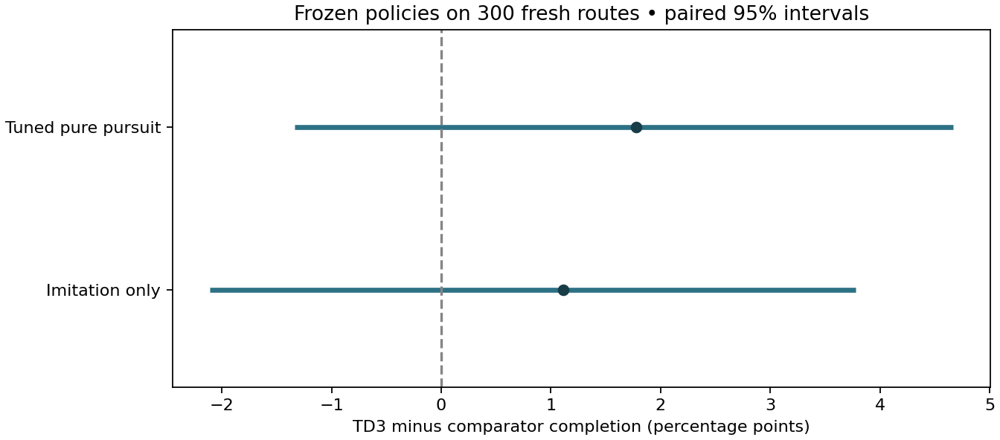
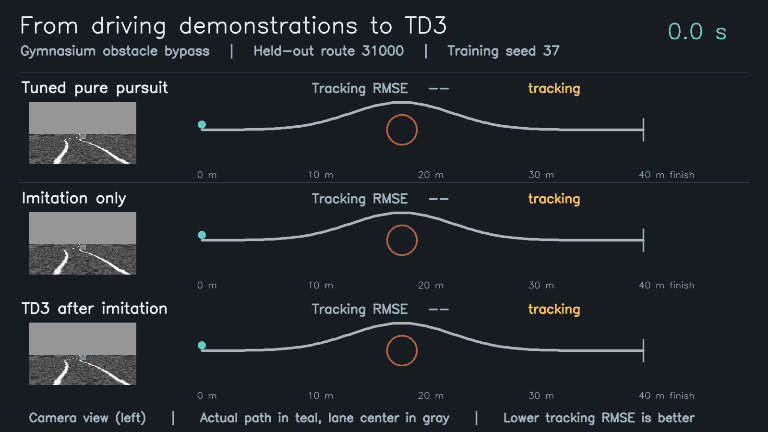
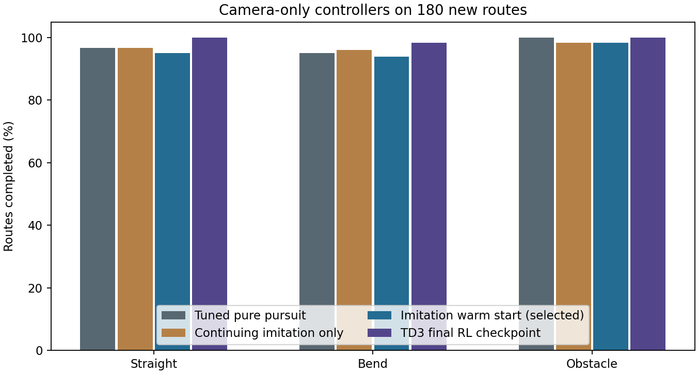

# Can a learned policy beat its geometric teacher?

## What replicated on 300 fresh routes

The final TD3 networks produced steering and acceleration directly from camera-derived features. Replaying the same three frozen networks produced **880 clean finishes in 900 trials (97.8%)**, with **zero recorded contacts**. Tuned pure pursuit finished **288/300 (96.0%)** and continued imitation finished **870/900 (96.7%)**. Each learned policy faced the same 300 routes for each of three training seeds.

| Controller | Clean finishes | Recorded contacts | Mean episode lateral RMSE |
|---|---:|---:|---:|
| Tuned pure pursuit, 4 m/s target | 288/300 (96.0%) | 0 | 0.171 m |
| Continued imitation only | 870/900 (96.7%) | 0 | 0.171 m |
| Final TD3 after imitation | 880/900 (97.8%) | 0 | 0.214 m |

**The advantage depended on the training seed.** The TD3 actors finished 286, 296 and 298 routes respectively. Against tuned pure pursuit the paired gain was +1.78 percentage points, with a 95% bootstrap interval of −1.33 to +4.67. Against imitation the gain was +1.11 points, with an interval of −2.11 to +3.78. Both comparisons missed the prespecified criterion for a consistent RL improvement.

TD3 reached the finish 0.05 s later on average than the tuned teacher on their 849 paired finishes. The teacher tracked the lane more closely, with mean episode lateral RMSE of 0.171 m versus 0.214 m for TD3. [Replication scores, intervals and timings](../results/td3/confirmation/summary.json)



[](https://nandhini1github.github.io/RL-TD3-Driving-Geometric-Vision/#td3)

The replay uses route 31000 and training seed 37. The overhead path and running tracking error are drawn only for evaluation. [Watch the full-resolution replay](https://nandhini1github.github.io/RL-TD3-Driving-Geometric-Vision/#td3)

## Initial study on 180 routes

| Controller | Clean finishes | Recorded contacts | Mean episode lateral RMSE |
|---|---:|---:|---:|
| Tuned pure pursuit | 175/180 (97.2%) | 0 | 0.176 m |
| Continued imitation only | 524/540 (97.0%) | 0 | 0.178 m |
| Validation-selected TD3 branch, all three selected the imitation warm start | 517/540 (95.7%) | 0 | 0.178 m |
| Final TD3 actors after RL updates | 537/540 (99.4%) | 0 | 0.220 m |

The **original primary criterion was unmet**. The checkpoint selector favored an actor with zero RL updates for all three training seeds. On the same routes the separately specified final actors completed 177, 180 and 180 routes. Their paired gain over pure pursuit was 2.22 percentage points, with a 95% bootstrap interval of −0.37 to +5.00. Against continued imitation the gain was 2.41 points, with an interval of −0.56 to +6.11. Those exploratory gains motivated the frozen-policy replication below. The 540 trials use the same 180 distinct routes for three trained actors. [Initial scores and uncertainty intervals](../results/td3/summary.json)



## Protocol fixed before final testing

The task is the existing 40 m camera-based Gymnasium route. The primary outcome is completion without a reference contact or departure. Compare the published tuned pure-pursuit controller (4.5 m lookahead, 4 m/s target) with two standalone neural policies: imitation only and imitation followed by offline TD3 with a demonstration penalty. These three comparators receive the original 11 inputs, including camera-derived features and the previous commands. The networks output steering and acceleration directly at inference.

**Decision rule.** To claim an RL completion advantage, TD3 must finish a greater fraction than both the geometric teacher and imitation alone for every training seed. Its pooled contact rate must be no higher than either comparator. The lower bound of the paired 95% bootstrap interval for each completion difference must exceed zero. Report all training seeds, contacts and tracking error even if the criterion is missed. Arrival time on mutually successful routes is secondary. Different policies can finish different subsets.

## Data and training

* Collect 64 training episodes per scene on seeds 2000–2063. One quarter use the tuned teacher's actions. The others vary speed, lookahead and action noise to provide recovery and failure examples. Save the executed action, the teacher's action on the same observation, a camera-derived reward, next observation and terminal flag. Training never reads map pose, reference contact or ground-truth speed.
* Initialize each actor with 2,400 minibatches of behavior cloning. Both branches start with identical weights. Then take 3,200 further actor updates per branch with the same minibatches, teacher labels and learning rate. Only the RL branch trains twin critics on the rewards and adds a value term to the actor loss. This is an offline TD3 variant using a geometric teacher for the imitation target. The original TD3+BC algorithm regularizes toward dataset actions.
* Use seeds 37, 83 and 109, and share the training dataset. Choose from the warm-start actor and four subsequent checkpoints per branch using 30 camera-scored validation cases on seeds 6700–6709. Rank by visual completions, then fewer visual hazards, then lower visual lane RMSE. Keep the earlier checkpoint in a tie. Log whether the warm-start policy won.
* Freeze all selected weights before evaluating seeds 22000–22059 in each of three scenes (180 new routes). Compare on matched scene and seed and include all runs. Resample route seeds in blocks that retain all three scenes, and resample the three training seeds. The geometric teacher is scored once on the 180 routes.

The separately reported final TD3 checkpoints received all 3,200 RL actor updates. This secondary comparison was specified before opening the held-out set. [TD3 paper](https://proceedings.mlr.press/v80/fujimoto18a.html) · [TD3+BC paper](https://arxiv.org/abs/2106.06860)

### Independent replication protocol

The secondary final-TD3 comparison in the first 180 routes motivated one independent replication. Before testing, freeze the three final TD3 actors and the three selected continuing-imitation actors, without further updates or selection. Evaluate seeds 31000–31099 in all three scenes (300 distinct routes). The primary comparators are the published tuned teacher and continuing imitation. Use the same per-seed, contact and paired-interval criteria as before, now applied to the final RL actors. Report paired travel time and tracking error. Publish this one replication irrespective of outcome.

## What changes during the RL updates?

The actor starts by minimizing squared error against the teacher's steering and acceleration. During the RL phase, two critics learn discounted future camera reward from the actions actually driven in the simulator. Their training target uses the smaller target-network value, target-action smoothing, a 0.99 discount and zero bootstrap after the end of an episode. Every second critic update, the actor balances imitation error against the first critic's estimate of its proposed action's value. The imitation-only control receives the same minibatch of observations and labels on each such step. The actor uses only its learned weights and training-set normalization at deployment.

The reward credits visual progress and adds 25 for a visual finish. It charges 0.12 per step, 0.10 times absolute measured lane offset, 0.08 times absolute steering change, and 1.5 for a frame with missing lane or speed. A visual hazard or lane failure incurs 25, and a timeout without another terminal event incurs 12. Independent collision and finish references never enter the training targets.

## Reproduce

```powershell
$py = ".\.venv\Scripts\python.exe"
& $py -m td3_training.td3_camera collect
foreach ($seed in 37,83,109) { & $py -m td3_training.td3_camera train --seed $seed }
& $py -m td3_training.td3_camera test --arm pursuit
foreach ($seed in 37,83,109) {
    foreach ($arm in 'td3','clone','final') { & $py -m td3_training.td3_camera test --arm $arm --seed $seed }
}
& $py -m evaluation.td3_results
& $py -m td3_training.td3_camera test --confirm --arm pursuit
foreach ($seed in 37,83,109) {
    foreach ($arm in 'final','clone') { & $py -m td3_training.td3_camera test --confirm --arm $arm --seed $seed }
}
& $py -m evaluation.td3_results --confirm
& $py -m evaluation.rl_video
```
